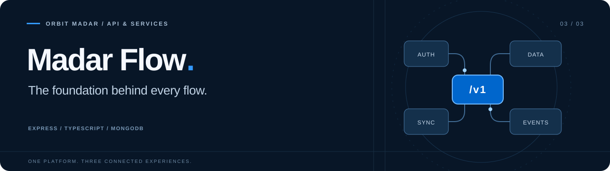

<div align="center">
  

# Madar Flow · API

**One foundation for every financial workflow.**

The backend for Madar Flow by **Orbit Madar**.<br>
REST contracts, financial records, synchronization, access control, and realtime delivery.


[Overview](#overview) · [Quick start](#quick-start) · [Configuration](#configuration) · [API documentation](#api-documentation) · [Operations](#operations) · [Development](#development)

<p dir="rtl">الخادم الخلفي لمدار فلو: إدارة البيانات والمصادقة والصلاحيات والمزامنة والإشعارات والتحليلات.</p>
</div>

---

## Overview

Madar Flow API serves the consumer app and administration dashboard through a versioned Express API. MongoDB stores financial and account data; shared services coordinate synchronization, notifications, billing, and administrative workflows.

| Domain | Responsibility |
| --- | --- |
| Identity and sessions | Password and Google authentication, session-bound JWT access, rotating refresh sessions, and account recovery. |
| Financial records | Income/expense records, categories, ownership checks, and validation. |
| Synchronization | Offline reconciliation, receipts, idempotency, conflicts, and failure tracking. |
| Access and plans | Roles, permissions, scopes, temporary grants, and subscription entitlements. |
| Notifications | Canonical notifications, per-user inbox state, preferences, broadcasts, Socket.IO, and Firebase delivery. |
| Administration | User management, analytics, audit logs, health, and scheduled reports. |
| App content | Public app settings and guarded administration of support, legal, and version content. |
| Billing | RevenueCat webhook integration, purchase reconciliation, and billing-event handling. |

### Part of one platform

| Repository | Responsibility |
| --- | --- |
| [Madar-Flow-Mobile](https://github.com/Soliman-Shahin/Madar-Flow-Mobile) | Consumer UI, offline storage, synchronization UI, and native device integration. |
| [Madar-Flow-Admin](https://github.com/Soliman-Shahin/Madar-Flow-Admin) | Browser administration, analytics, and operational tools. |
| **Madar-Flow-BE** · this repository | API behavior, persistence, authentication, authorization, and delivery. |

The repositories install and build independently.

## Quick start

Use **Node.js 22+**, npm, and a reachable MongoDB instance. Node.js **22.12+ within the 22.x release line** is a compatible common baseline when working across all three repositories.

```sh
git clone https://github.com/Soliman-Shahin/Madar-Flow-BE.git
cd Madar-Flow-BE
npm ci
cp .env.example .env
```

Complete the local `.env` using the configuration guide below. Replace template values with your own development configuration before starting:

```sh
npm run dev
```

The server defaults to port **3000**. It connects to MongoDB and seeds default plans before opening the HTTP listener.

| Local URL | Purpose |
| --- | --- |
| [http://localhost:3000/v1](http://localhost:3000/v1) | REST API base; append a resource path. |
| [http://localhost:3000/api-docs](http://localhost:3000/api-docs) | Swagger UI from source annotations. |
| [http://localhost:3000/health](http://localhost:3000/health) | Basic health check. |
| [http://localhost:3000/health/ready](http://localhost:3000/health/ready) | Readiness check. |

## Configuration

Start with the tracked [.env.example](.env.example). Keep real values in the untracked `.env` or the host's private environment configuration.

### Core runtime

| Variable | Purpose |
| --- | --- |
| `MONGO_URI` | MongoDB connection string; required at startup. |
| `ACCESS_TOKEN_SECRET` | Secret for signing access tokens; required at startup. |
| `REFRESH_TOKEN_SECRET` | Separate secret for refresh-token handling; required at startup. |
| `ENCRYPTION_KEY` | Nontrivial encryption passphrase, at least 32 characters; validated at startup. |
| `PORT` | HTTP port; defaults to `3000`. |
| `NODE_ENV` | Runtime mode, including production-specific behavior. |
| `ALLOWED_ORIGINS` | Comma-separated additional allowed browser origins. |

Generate distinct random values for the token secrets and encryption key. Do not reuse production credentials for local development.

### Integrations

| Integration | Configuration |
| --- | --- |
| Google OAuth | `GOOGLE_CLIENT_ID`, `GOOGLE_CLIENT_SECRET`, `GOOGLE_CALLBACK_URL`; native Google verification also uses `GOOGLE_WEB_CLIENT_ID`. |
| Firebase Admin | `FIREBASE_PROJECT_ID`, `FIREBASE_CLIENT_EMAIL`, `FIREBASE_PRIVATE_KEY`. |
| Transactional email | `RESEND_API_KEY`, `RESEND_FROM_EMAIL`, and the relevant recovery/deletion destination URLs. |
| Billing | See [billing configuration](src/app/config/billing.config.ts) and [billing foundation](docs/billing-foundation.md). |

The Google OAuth strategy initializes when the application loads, so configure its client credentials even when first exercising password-based flows. Missing Firebase Admin configuration disables push delivery without stopping the API. Other integrations need their own configuration before their workflows can succeed.

## API documentation

The mounted REST prefix is **`/v1`**. Authentication routes are under **`/v1/user`**, with a singular `user` segment.

| Route family | Domain |
| --- | --- |
| `/v1/user` | Authentication, sessions, profile, and account workflows. |
| `/v1/expenses`, `/v1/categories` | Financial records and categories. |
| `/v1/sync` | Synchronization and reconciliation. |
| `/v1/plans`, `/v1/scopes`, `/v1/permissions`, `/v1/roles` | Plans and access control. |
| `/v1/temporary-permissions` | Time-limited permission grants. |
| `/v1/notifications`, `/v1/push` | Inbox, preferences, broadcasts, and push-device registration. |
| `/v1/admin`, `/v1/audit-logs` | Administrative operations, analytics, and audit access. |
| `/v1/app-settings`, `/v1/telemetry` | Public app content and opt-in usage events. |
| `/v1/billing`, `/v1/admin/billing` | Provider callbacks, purchase sync, and guarded billing tools. |

These are route families, not a promise that each root accepts a request. Individual operations define their own method, payload, authentication, and authorization requirements in the [router tree](src/app/routes/index.ts).

### Authentication and access

Protected operations use session-bound JWT access tokens. Browser and native refresh/session flows use different transports; browser cookie flows include CSRF handling. Roles, plans, scopes, permissions, and ownership checks are enforced by the relevant middleware stack.

Use the existing client authentication flow or the generated collection rather than assuming one token transport fits every endpoint. Provider webhooks have their own authentication requirements.

### Local OpenAPI and Postman catalog

Generate reusable API artifacts from the router tree, annotations, and reviewed contracts:

```sh
node scripts/build-postman-catalog.cjs
node scripts/build-postman-collection.cjs
node scripts/build-postman-multifile-spec.cjs
node scripts/validate-postman-catalog.cjs
```

The output includes `postman/openapi.json`, `postman/collection.json`, and a multi-file specification under `postman/spec/`. The generated `postman/` directory is ignored by Git and can be recreated from the tracked scripts.

Import the generated collection into Postman and set its local environment variables. Its host guard restricts routine requests to `localhost` and `127.0.0.1`; secret exports remain blank. Some operations have detailed schemas, while others retain open data shapes. Catalog validation checks artifacts and route coverage; it does not call the API or establish endpoint runtime success.

Swagger UI is a separate annotation-based view. For integrations, cross-check the generated catalog with current routes and validators when an annotation is incomplete.

## Operations

### Health and lifecycle

| Endpoint | Purpose |
| --- | --- |
| `GET /health` | Basic service health. |
| `GET /health/detailed` | Detailed diagnostic health. |
| `GET /health/ready` | Readiness, including database availability. |
| `GET /health/live` | Process liveness. |

The same health router is also mounted at `/v1/health`.

After HTTP startup, the server starts subscription reminders, notification archival/retention, session cleanup, permission expiry, audit retention, and analytics report scheduling. `SIGTERM` and `SIGINT` stop jobs and close Socket.IO, HTTP, and MongoDB, with a ten-second shutdown timeout.

Scheduled-job status is process-local and resets after a restart. See [server.ts](src/app/server.ts) and [jobs/](src/app/jobs) for lifecycle wiring and schedules.

### Build and hosting

```sh
npm run build
npm start
```

TypeScript emits `dist/`; production starts **`node dist/app/server.js`**. Tests are excluded from the production compiler configuration.

[railway.toml](railway.toml) configures Nixpacks, `/health/ready` deployment health checks, restart behavior, and connection draining. Hosting must support the HTTP server, long-lived Socket.IO connections, and scheduled jobs. When diagnosing an unexpected deployed response, verify the running commit before assuming the local source is at fault.

## Development

### Source map

```text
src/app/
├── routes/          # Paths and middleware order
├── controllers/     # HTTP translation and response handling
├── services/        # Business logic and cross-channel workflows
├── models/          # Mongoose documents, indexes, and persistence
├── validations/     # Request validation schemas
├── middleware/      # Auth, access, validation, rate limits, and audit
├── config/          # Provider and runtime configuration
├── jobs/            # Scheduled lifecycle work and run status
├── db/              # MongoDB connection lifecycle
├── app.ts           # Express application composition
└── server.ts        # Startup, HTTP/Socket.IO, jobs, and shutdown
scripts/             # API catalog generation/validation and load tooling
docs/                # Domain and operational documentation
```

### Commands and checks

| Command | Purpose |
| --- | --- |
| `npm run dev` | Start the watched TypeScript development server. |
| `npm run build` | Compile the production application. |
| `npm start` | Run the compiled server. |
| `npm test -- --runInBand` | Run Jest tests serially. |
| `npm test -- --runInBand <test-path>` | Run a focused test file. |
| `node scripts/validate-postman-catalog.cjs` | Validate previously generated API artifacts. |

Jest uses [tsconfig.test.json](tsconfig.test.json). Database-backed tests use `mongodb-memory-server`, which needs a runnable MongoDB test binary and may need network access for its initial download. Use isolated test data for state-changing requests.

For API changes, trace both known clients before changing request or response contracts. Keep controllers thin, preserve middleware order and access enforcement, run focused checks, and review `git diff --check` before handoff.

## Further reading

| Guide | Scope |
| --- | --- |
| [Dashboard analytics](docs/dashboard-analytics.md) | Baseline metrics, periods, and interpretation. |
| [Analytics explorer](docs/analytics-explorer.md) | Filtering, engagement, subscriptions, and reporting. |
| [Billing foundation](docs/billing-foundation.md) | Billing events, entitlements, and provider integration. |
| [Load testing](docs/load-testing.md) | Local load-test tooling and measurement. |

For bugs, include the route/method, reproduction steps, expected behavior, and sanitized logs in a [repository issue](https://github.com/Soliman-Shahin/Madar-Flow-BE/issues).

---

<div align="center"><strong>Madar Flow</strong> by Orbit Madar<br><sub>Connected experiences. A consistent foundation.</sub></div>
